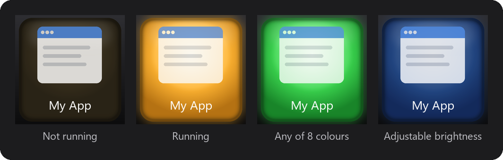

# App Launcher Key

A Logi Options+ plugin for the MX Creative Keypad and MX Keypad. Put an application on a key: pressing the key launches
the application, and the key lights up like a lamp while the application is running.



*Rendered preview of a key in different states.*

## Features

- Pick an application from the installed applications Logi Options+ knows about. The key shows the application's icon
  and name.
- The lamp turns on when the application starts and goes out when it exits, whoever started it.
- Each key has its own lamp colour (8 colours) and brightness (20–100 %).
- Optionally, pressing the key while the application runs asks it to close.
- For applications started through a launcher, choose the program that actually runs, so the lamp follows it.

## Requirements

- Windows with [Logi Options+](https://www.logitech.com/software/logi-options-plus.html), which installs Logi Plugin
  Service.
- Logi Plugin Service 6.4 or later.
- MX Creative Keypad or MX Keypad. Tested on the MX Creative Keypad with Logi Plugin Service 6.4.2.

## Installation

Download `AppLauncherKey_<version>.lplug4` from [Releases](https://github.com/siilky/app-launcher-key/releases) and
double-click it: Logi Plugin Service installs the plugin. Plugins from outside Logi Marketplace install with a security
warning. You can also [build the plugin from source](#building-from-source).

## Usage

1. In Logi Options+, open the customization of your keypad.
2. Find **App Launcher Key** among the installed plugins and drag **Launch App** onto a key.
3. Choose the application, the lamp colour and brightness, and the other options, then save.

When you save a key, Logi Options+ stores a static snapshot of its icon. Right after a save, the plugin deletes icon
snapshots of its own keys written in the last few seconds, so the key keeps showing its live state. An icon you drew in
the Icon Editor for one of its keys just before saving can be removed too. Icons of other actions and all other files of
Logi Options+ are never touched.

### Known limitations

- A copied or pasted key keeps a static icon until you reset the key's icon in Logi Options+.
- Closing asks the application's main window to close. An application minimised to the tray has no window, so pressing
  the key starts it again instead.

## Uninstallation

Uninstall the plugin in Logi Options+, or run:

```powershell
logiplugintool uninstall AppLauncherKey
```

The plugin installs nothing outside its own folder. Keys assigned to it stay in your Logi Options+ profiles until you
remove them.

## Building from source

The plugin API comes from the [LogiPluginApi](https://www.nuget.org/packages/LogiPluginApi) NuGet package; running the
plugin needs Logi Options+. Building requires the [.NET 10 SDK](https://dotnet.microsoft.com/download/dotnet/10.0) and
Logi Plugin Tool:

```powershell
dotnet tool install --global LogiPluginTool --version 6.1.4.22672
```

Development build: it registers the build output with Logi Plugin Service through a `.link` file and reloads the plugin.

```powershell
dotnet build AppLauncherKeyPlugin/src/AppLauncherKeyPlugin.csproj
```

Package:

```powershell
dotnet build -c Release AppLauncherKeyPlugin/src/AppLauncherKeyPlugin.csproj
logiplugintool pack AppLauncherKeyPlugin/bin/Release/ AppLauncherKey.lplug4
logiplugintool verify AppLauncherKey.lplug4
dotnet clean AppLauncherKeyPlugin/src/AppLauncherKeyPlugin.csproj
logiplugintool install AppLauncherKey.lplug4
```

`dotnet clean` removes the development `.link`, so only the installed copy of the plugin loads.

Releases are built by GitHub Actions: pushing a tag `v<version>` that matches `version` in
`AppLauncherKeyPlugin/src/package/metadata/LoupedeckPackage.yaml` builds, packs and verifies the plugin and publishes the
package as a release.

The lamp images in `AppLauncherKeyPlugin/src/Resources` and the store art are rendered by the Python scripts in
`AppLauncherKeyPlugin/tools` (Pillow and numpy).

## Project layout

| Path | Contents |
|---|---|
| `AppLauncherKeyPlugin/src/Actions/AppKeyCommand.cs` | The **Launch App** action: application list, key drawing, process tracking. |
| `AppLauncherKeyPlugin/src/AppSettings.cs` | Per-key settings. |
| `AppLauncherKeyPlugin/src/package/metadata` | Package manifest, plugin icon and key layout template. |
| `AppLauncherKeyPlugin/tools` | Image render scripts. |
| `.github/workflows/release.yml` | Release build. |

## Support

Report problems and suggestions in [Issues](https://github.com/siilky/app-launcher-key/issues) or write to
<silkytails@outlook.com>.

## Privacy

The plugin sends no data anywhere and makes no network connections. It writes diagnostic entries, such as application
names and file paths, to the Logi Plugin Service log on your computer.

## License

[MIT](LICENSE). Use of the plugin is also covered by the [EULA](EULA.md).

This project is not affiliated with or endorsed by Logitech. Logitech, Logi, Logi Options+ and MX are trademarks of
Logitech.
